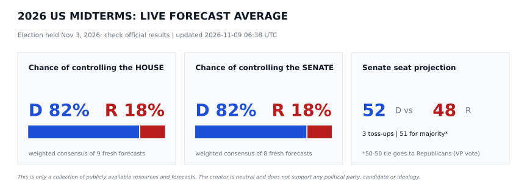
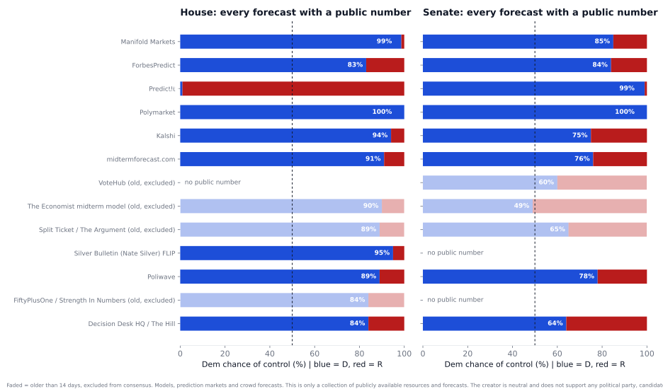
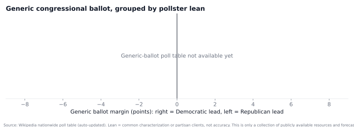
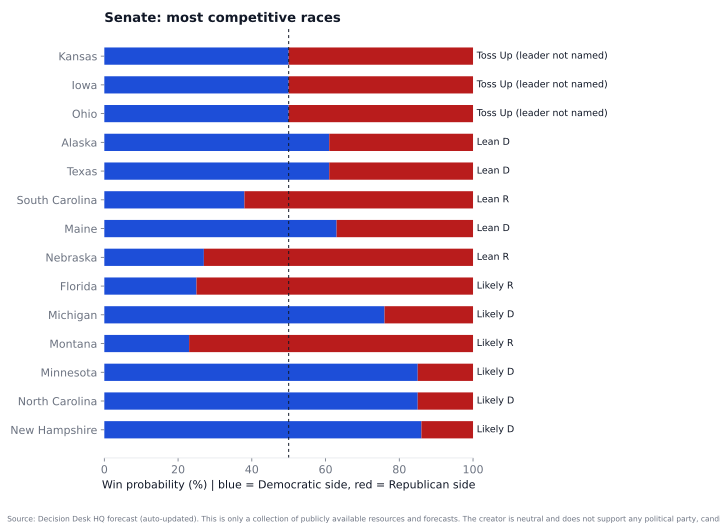
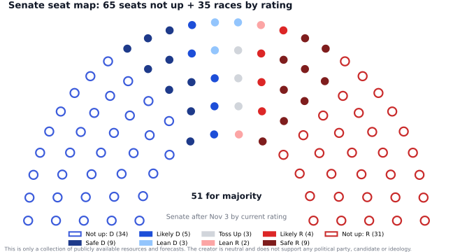
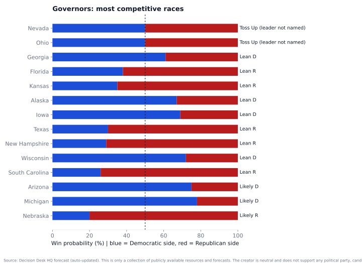
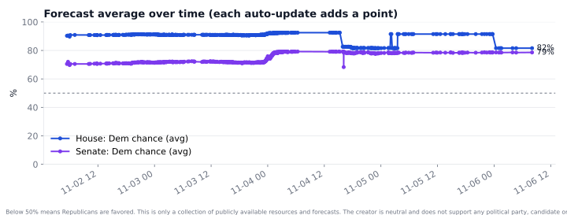
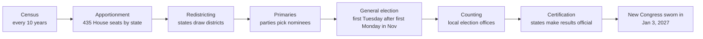
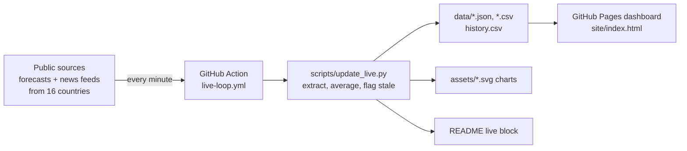

> ## 🙋 Too technical or too much code?
> ### 👉 **[View the Dashboard / Website](https://aravindb98.github.io/us-midterm-elections-2026-/)**
> **Midterms 2026 · Live Desk**: live gauges, a Senate Monte Carlo simulator, a state map, a votes-to-win calculator (turnout, votes needed and every poll's lead in real votes), candidate profiles, a campaign trail (Trump, Obama, Vance, Harris and both parties' ads and news), polls by pollster lean, world headlines from 16 countries and 146 sources, refreshed **every minute**. Mobile-friendly, no GitHub account or coding needed.

> ### 🎬 **[Watch the 60-second video tour on YouTube](https://youtu.be/rSkGzIMN0mc)**

[](https://youtu.be/rSkGzIMN0mc)

<div align="center">

### ⭐ Star · 🍴 Fork · 👤 Follow

**If this is useful, please [⭐ star the repo](https://github.com/AravindB98/us-midterm-elections-2026-) so others can find it, [🍴 fork it](https://github.com/AravindB98/us-midterm-elections-2026-/fork) to build your own version, and [👤 follow @AravindB98](https://github.com/AravindB98) for updates.**

[](https://github.com/AravindB98/us-midterm-elections-2026-/stargazers)
[](https://github.com/AravindB98/us-midterm-elections-2026-/fork)
[](https://github.com/AravindB98)

</div>

---

<div align="center">

# 🗳️ US Midterm Elections 2026 (Nov 3)

### The US election system, explained, plus a **live, auto-updating** forecast tracker for the **2026 midterms**

[](https://github.com/AravindB98/us-midterm-elections-2026-/actions/workflows/update-live.yml)
[](https://aravindb98.github.io/us-midterm-elections-2026-/)


</div>



---

## 📡 Live forecast (auto-updated)

Every minute a GitHub Action re-reads the public forecasters below, extracts the latest win probabilities, recomputes the averages, redraws every chart, and rewrites this section. If a source can't be read, its last good value is kept and marked **stale**, so numbers never silently disappear. Every figure links to its source.

<!-- LIVE:START -->
_Last automatic update: **2026-11-13 04:00 UTC**. Markets refresh every minute, headlines every 5 minutes, everything else every 15 minutes (GitHub Actions)._

### 🧾 Conclusion (auto-generated from all sources)

- House: Democrats favored (weighted average 82% Democratic across 9 fresh sources; 89% of sources favor Democrats). Range: 1% (PredictIt) to 100% (Polymarket). Sources disagree substantially, so treat this as uncertain.
- Senate: Democrats favored (weighted average 81% Democratic across 8 fresh sources; every source favors Democrats). Range: 64% (Decision Desk HQ / The Hill) to 100% (Polymarket). Sources disagree substantially, so treat this as uncertain.
- Expert raters (Cook, Fox News Power Rankings) see the Senate as closer than most models: Cook calls Democrats slight favorites and Fox rates Senate control a toss-up. Polling errors of 3 to 5 points in one direction have happened before, which would change the Senate outcome.

| Consensus (weighted) | Democrats | Republicans | Fresh sources | Range across sources | Verdict |
|---|---|---|---|---|---|
| **House control** | 81.6% | 18.4% | 9 | 1% to 100% | Democrats favored |
| **Senate control** | 80.9% | 19.1% | 8 | 64% to 100% | Democrats favored |
| **Senate seats (expected)** | 52.0 | 48.0 | DDHQ race odds | - | 51 needed |

**Forecasts in the consensus**

| Source | Type | House (D) | Senate (D) | As of |
|---|---|---|---|---|
| [Decision Desk HQ / The Hill](https://votes.decisiondeskhq.com/forecast/2026) | Forecast models | 84.0% | 64.0% | 2026-11-02 |
| [Poliwave](https://www.poliwave.com/us/fed/projection) | Forecast models | 89.0% | 78.0% | 2026-11-02 |
| [Silver Bulletin (Nate Silver) FLIPR](https://www.natesilver.net/p/nate-silver-2026-midterm-election-polls-model) | Forecast models | 95.0% | n/a | 2026-11-02 |
| [midtermforecast.com](https://midtermforecast.com/) | Forecast models | 91.0% | 76.0% | 2026-11-13 |
| [Kalshi](https://news.kalshi.com/p/2026-midterm-predictions) | Prediction markets | 94.1% | 75.0% | 2026-11-13 |
| [Polymarket](https://polymarket.com/) | Prediction markets | 100.0% | 100.0% | 2026-11-04 |
| [PredictIt](https://www.predictit.org/) | Prediction markets | 1.0% | 99.0% | 2026-11-13 |
| [ForbesPredict](https://www.forbes.com/sites/saradorn/2026/11/01/latest-polls-in-2026-midterms-democrats-lead-nearly-all-key-senate-races/) | Crowd forecasts | 83.0% | 84.0% | 2026-11-01 |
| [Manifold Markets](https://manifold.markets/) | Crowd forecasts | 98.7% | 77.0% | 2026-11-13 |

All 179 sources, grouped by type (models, markets, raters, pollsters, news, TV, social, academic, AI, repos): **[docs/09](docs/09-all-sources-consensus.md)**.

**Closest Senate races right now**

| State | Democrat | Republican / other | Rating | Win prob. (favored side) |
|---|---|---|---|---|
| Kansas | Adam Hamilton | Roger Marshall (inc.) | Toss Up | 50% |
| Iowa | Josh Turek | Ashley Hinson | Toss Up | 53% |
| Ohio | Sherrod Brown | Jon Husted (inc.) | Toss Up | 55% |
| Alaska | Mary Peltola | Dan Sullivan (inc.) | Lean D | 61% |
| Texas | James Talarico | Ken Paxton | Lean D | 61% |
| South Carolina | Annie Andrews | Lindsey Graham (inc.) | Lean R | 62% |
| Maine | Troy Jackson | Susan Collins (inc.) | Lean D | 63% |
| Nebraska | - | Pete Ricketts (inc.); Dan Osborn (I) | Lean R | 73% |
| Florida | Angie Nixon | Ashley Moody (inc.) | Likely R | 75% |
| Michigan | Abdul El-Sayed | Mike Rogers | Likely D | 76% |

**Latest midterm headlines (auto-updated)**

- [What are the key takeaways from the 2026 midterm elections?](https://news.google.com/rss/articles/CBMihAFBVV95cUxObk5CeEdadVN3VmhFTjYtR1h3WVdxVFBQMGFnUzRJWTNwRG50ZnpYSDFibTZ2SVpYT00xT2JRQWhBWDRhSEc2TXJ5Y0JFcjVwTDM3d1FCNGgzZzZWQk1GNDd5bmJnQUpVQ1FGQy1kVGtPTVU3cF95dHR1cF9HanJ0TUd6a2k?oc=5) (Campaign Legal Center)
- [The 2026 midterm elections showed DEI is alive and well](https://news.google.com/rss/articles/CBMilgFBVV95cUxQQUZSWm1PVzNCaU5XV3BHb2M3dHZ1N3c3R0xVendreEhsMGotbF95dDFKN001eE5BWC1tMnRWSTlLNDRuUXdPcGxlbTFFTzRPckVZbS12OXM1ek9OV2tFcFNpaUdJVm4tTTRBMGZqeHEtQWo1eW80cUx2TFZTWWdSdEhOanB2cWtZVTVzT2VPRGY1a1JYYnc?oc=5) (Brookings)
- [The consequences of the US midterm elections](https://news.google.com/rss/articles/CBMiqgFBVV95cUxPeHhhODFBQk9wTGF5TUJMWGtVRGg0cGtxVzkwR3Z3d2JWaWFHQlpZR2VadEZGUi1WVFZiY3NFTXpfdmdic2hLVFpRN3dhQUZocUNfZ2YwNTg2X2NHQV9MT01jWm9ZQUpZZWlZaW9Ja3JHa1c2NWplZ2s4eVpBV0xfdWNEZ3dZNGJYQlN4Y2FZa0NMUEJ0UDRHOUItV1prRDhnZXNYUGpQaHJHUQ?oc=5) (The International Institute for Strategic Studies)
- [The historic firsts of the 2026 midterm elections](https://news.google.com/rss/articles/CBMiiwFBVV95cUxQMWQ5VWd5bGxuNEU1c0MtdjAydjlzbjR1Z3hNa2M5Zlh5ZGlueEpkRE9GN1dRVjYtbXdsSTVVQzlMM1BhZ2VjcWtXSWNuQm5hdkFXa3o2SXU4a0NLWFZ2bjlzUlIxa2xtdlhUTlpJNEFpUGFVNm5RN3h5ZXQwZkNyZm1UZUNmdjFsZlZ3?oc=5) (Ash Center)
- [The 2026 Election by the Numbers](https://news.google.com/rss/articles/CBMiaEFVX3lxTE1vWmVLVTdGcU5xWUZEWE9iR2hjbXBDdHpibE8xYkpvbnlJS0RCeFVqSFh1cDNyUEdST1EwQjE4clpjMEUyT1pKcXo1T2lhN3NPZ2lOa2t0TFM2OWhZdjlrMG8xTC1tMlk1?oc=5) (Council on Foreign Relations)

Headlines from all 16 countries: [docs/08](docs/08-global-media-and-research-sources.md) and the dashboard's World media tab.

> Forecasts are probabilities, not results. On and after Nov 3, follow official state results and AP / DDHQ race calls.
<!-- LIVE:END -->

### Charts













---

## 🧭 How US elections work, at a glance



| What's on the 2026 ballot | Count | Majority needed | Current control |
|---|---|---|---|
| US House | 435 seats (all) | 218 | Republicans, about 218-214 |
| US Senate | 35 of 100 seats | 51 (or 50 + VP) | Republicans, 53-47 |
| Governors | 36 of 50 | n/a | GOP holds 26 of 50 governorships |
| Ballot measures | dozens | n/a | voter ID, citizen-only voting, abortion, redistricting, taxes |

Full explainer: **[docs/01 How US elections work](docs/01-how-us-elections-work.md)**

---

## 📚 Contents

| # | Document | What you'll find |
|---|---|---|
| 1 | [How US elections work](docs/01-how-us-elections-work.md) | Federal vs state roles, census, redistricting, primaries, voting, counting, Electoral College, money |
| 2 | [2026 midterms analysis](docs/02-midterms-2026-analysis.md) | Environment, forecasts compared, Senate path to 51, House, governors, redistricting wars, ballot measures, election-night clock, scenarios |
| 3 | [State-by-state outlook](docs/03-state-by-state-outlook.md) | All 35 Senate and 36 governor races: who has the higher probability, ratings, polls |
| 4 | [Census and official data](docs/04-census-and-data-sources.md) | Census Bureau voting data, apportionment, ACS, CVAP, EAC, FEC, state offices, open datasets |
| 5 | [Media, forecasters, polls](docs/05-media-and-forecasters.md) | Race raters, models, poll averages, prediction markets, results desks, media-literacy checklist |
| 6 | [Research and studies](docs/06-research-and-studies.md) | CES, ANES, MIT, Pew, think tanks across the spectrum, Northeastern research |
| 7 | [**Non-citizens: students and workers**](docs/07-non-citizens-students-and-workers.md) | Can't vote (and the penalties), what you *can* do, H-1B / OPT / F-1 policy stakes, scenarios, checklist |
| 8 | [**Global media and research (16 countries)**](docs/08-global-media-and-research-sources.md) | TV, print, social and think tanks from the 10 most populous countries and 10 largest economies, with **auto-updated headlines** from each |
| 9 | [**All sources, consensus and conclusion**](docs/09-all-sources-consensus.md) | 146 sources by type (models, markets, raters, pollsters of every lean, news, TV, social, academic, AI, repos), weighted consensus and auto-written conclusion |

---

## 🎓 For international students and visa workers (quick version)

| ✅ You can | ❌ You cannot |
|---|---|
| Follow and discuss the election, attend public events | **Vote or register to vote** (federal/state), even if a DMV registered you by mistake |
| Volunteer **unpaid** for a campaign | Donate money to any candidate, party or PAC (federal, state or local) |
| Comment on proposed immigration rules at regulations.gov | Claim US citizenship on any form |
| Contact your representatives about policy | Take decision-making roles in a campaign |

**Nothing about your F-1, OPT or H-1B status changes automatically on Nov 3.** What changes is who controls Congress from January 2027. The fast-moving items are executive rules and court cases: the blocked $100,000 H-1B fee, the proposed OPT fees, the end of "duration of status", and the wage-weighted H-1B lottery. Details: [docs/07](docs/07-non-citizens-students-and-workers.md).

---

## ⚙️ How the live system works



| Piece | Path |
|---|---|
| Source list and extraction rules (edit here when a site changes) | [`data/sources.json`](data/sources.json) |
| Latest values + averages | [`data/latest.json`](data/latest.json) |
| World media list and live headlines | [`data/world_media.json`](data/world_media.json), [`data/headlines.json`](data/headlines.json) |
| Time series | [`data/history.csv`](data/history.csv) |
| Race-level data | [`data/senate_2026.csv`](data/senate_2026.csv), [`data/governors_2026.csv`](data/governors_2026.csv) |
| Votes to win | [`data/turnout_2022.csv`](data/turnout_2022.csv) (UF Election Lab, official 2022 ballots and eligible voters), [`data/race_polls.json`](data/race_polls.json) (final-week polls per race) |
| Updater | [`scripts/update_live.py`](scripts/update_live.py) |
| Website | [`site/index.html`](site/index.html) |
| Schedules | [`live-loop.yml`](.github/workflows/live-loop.yml): markets every minute, headlines every 5 min, full refresh every 15 min |
| Election night | [`scripts/results.py`](scripts/results.py) reads all 71 Senate and governor race pages every minute from 5 pm ET on Nov 3 and writes [`data/results.json`](data/results.json). A race shows as called only when its page records an AP or network call and two consecutive checks agree. Unofficial until states certify. |
| State view | Pick a state in the dashboard menu, or share a link like `?state=TX`, to see only that state's races, turnout, votes to win, polls, news and results. |

Run locally:

```bash
pip install requests beautifulsoup4 lxml matplotlib
python3 scripts/update_live.py            # fetch live + rebuild
python3 scripts/update_live.py --offline  # rebuild charts from stored data
```

Method notes: the **average** is a simple mean of every source with a published number (models and one prediction market). Race-level probabilities come from Decision Desk HQ; for pure toss-ups DDHQ does not name a leader, so those are drawn at 50/50. Probabilities are not predictions of certainty: a 70% favorite loses 3 times in 10.

---

## ⭐ Support this project

- **[🎬 Watch and share the video tour](https://youtu.be/rSkGzIMN0mc)** on YouTube
- **[⭐ Star](https://github.com/AravindB98/us-midterm-elections-2026-)** to bookmark it and help others discover it
- **[🍴 Fork](https://github.com/AravindB98/us-midterm-elections-2026-/fork)** to adapt it for another election or country (all data and code are open)
- **[👤 Follow @AravindB98](https://github.com/AravindB98)** for more open-source projects
- Share the **[dashboard link](https://aravindb98.github.io/us-midterm-elections-2026-/)** with anyone who wants the plain-language version

## ⚖️ Disclaimer

> **This repository is only a collection of publicly available resources, data and forecasts. The creator is neutral and does not support or oppose any political party, candidate or ideology.** Numbers are reproduced from the cited sources, which may contain errors or change without notice. Nothing here is legal, immigration or financial advice. Non-citizens should consult their DSO or a licensed immigration attorney about their own situation.
